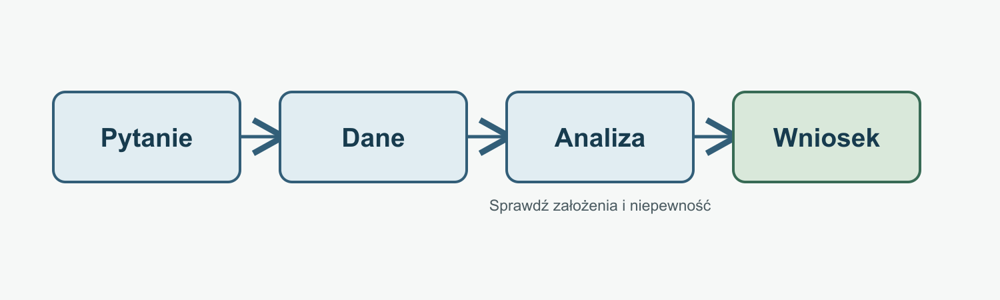

# Rozwiązania: grafika naukowa i użytkowa

Prace zapisano z edytowalnymi źródłami i eksportami. Schemat SVG przygotowano z osobnych obiektów i warstw, a PDF oraz PNG wyeksportowano programem Inkscape. Grupowanie i wyrównanie zapisano w strukturze SVG; nie wykonywałem tych operacji myszą w interfejsie Inkscape. Pozostałe grafiki powstały ze skryptów lub kodu TikZ. Dane wahadła są syntetyczne.

| Zadanie | Źródło | Wynik |
| --- | --- | --- |
| 2. Schemat procesu | [schemat.svg](schemat.svg) | [schemat.pdf](schemat.pdf), [schemat.png](schemat.png) |
| 3. Skalowanie rastrów | [resize_batch.py](resize_batch.py), [raport](raster_report.md) | [energia](batch/energia_800.png), [schemat](batch/schemat_800.png), [rezonans](batch/rezonans_800.png) |
| 4. Wykres wahadła | [CSV](wykres/wahadlo.csv), [skrypt](wykres/generuj_wykres.py), [opis](wykres/README.md) | [PDF](wykres/wahadlo.pdf), [PNG](wykres/wahadlo.png) |
| 5. TikZ | [schemat.tex](tikz/schemat.tex), [opis](tikz/README.md) | [schemat.pdf](tikz/schemat.pdf) |
| 6. Format TikZiT | [graf.tikz](tikzit/graf.tikz), [style](tikzit/graf.tikzstyles), [plik główny](tikzit/graf.tex), [opis](tikzit/README.md) | [graf.pdf](tikzit/graf.pdf); edycja w GUI niezweryfikowana |
| 7. Ilustracja AI | [prompt](ai/prompt.md), [ocena](ai/ocena.md) | [ilustracja.png](ai/ilustracja.png) |
| 8. Porównanie | [porownanie.md](porownanie.md) | porównanie źródeł i formatów |

Obrazy wejściowe do zadania 3 pochodzą z repozytorium: [energia.png](../../examples/01_markdown/files/sprezyna/energia.png), [schemat.png](../../examples/01_markdown/files/sprezyna/schemat.png), [rezonans.png](../../examples/01_markdown/files/sprezyna/rezonans.png). Uruchom `python resize_batch.py` z tego folderu. Wykres odtworzysz przez `python wykres/generuj_wykres.py`; diagram TikZ przez `pdflatex schemat.tex` w folderze `tikz/`.

W zadaniu 6 gotowy graf ma format źródłowy TikZiT i składa się do PDF, lecz nie był edytowany myszą w aplikacji. Ta część pozostaje do wykonania w TikZiT.

- [x] Źródła i eksporty zapisane.
- [x] Schemat, wykres i ilustracja mają odrębne zastosowania.
- [x] Wykres ma jednostki i informację o pochodzeniu danych.
- [ ] Wyrównanie i grupowanie wykonane ręcznie w interfejsie Inkscape.
- [ ] Diagram otwarty i edytowany w TikZiT.
