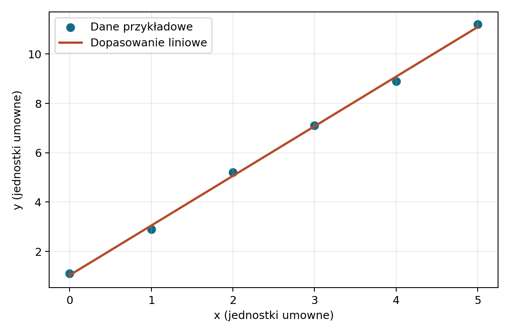

# Rozwiązania: obliczenia naukowe

Skrypty uruchomiono lokalnie w Pythonie z bibliotekami NumPy, SymPy i Matplotlib. Dane i wyniki są zapisane w tym folderze; skrypty używają ścieżek względem własnych plików.

| Zadanie | Źródło | Wynik |
| --- | --- | --- |
| Spadek swobodny | [python_calc.py](spadek/python_calc.py) | [python_results.txt](spadek/python_results.txt): $t=2{,}0193\,\mathrm{s}$, $v=19{,}8091\,\mathrm{m/s}$ |
| SymPy | [symbolic.py](sympy/symbolic.py) | [symbolic_results.txt](sympy/symbolic_results.txt): całka $1/3$ |
| Dopasowanie | [dane](dopasowanie/measurements.csv), [analyze_data.py](dopasowanie/analyze_data.py) | [fit_results.txt](dopasowanie/fit_results.txt), [PNG](dopasowanie/fit.png), [PDF](dopasowanie/fit.pdf) |
| Układ liniowy | [solve_system.py](uklad/solve_system.py) | [results.txt](uklad/results.txt): $x=2$, $y=1$ |
| OEIS | [oeis.py](oeis.py), [opis](oeis.md) | [oeis_results.txt](oeis_results.txt) |
| Precyzja `float` | [precision.py](precyzja/precision.py) | [precision_results.txt](precyzja/precision_results.txt) |
| Wolfram Alpha | [zapytania i porównanie](wolfram.md) | linki i oczekiwane odpowiedzi przygotowane; odpowiedzi serwisu nie zostały zweryfikowane w interfejsie wymagającym JavaScriptu |
| Octave (dodatkowe) | [solve_system.m](alternatywa/solve_system.m) | kod przygotowany, nieuruchomiony w tym środowisku |

Wynik regresji: $a=2{,}01143$, $b=1{,}03810$, $\mathrm{RMSE}=0{,}12319$ w jednostkach umownych. Dane są przykładowe.

## Odtworzenie

Z katalogu głównego repozytorium uruchom:

~~~text
python pages/solutions/07_sol_obliczenia_naukowe/spadek/python_calc.py
python pages/solutions/07_sol_obliczenia_naukowe/sympy/symbolic.py
python pages/solutions/07_sol_obliczenia_naukowe/dopasowanie/analyze_data.py
python pages/solutions/07_sol_obliczenia_naukowe/uklad/solve_system.py
python pages/solutions/07_sol_obliczenia_naukowe/oeis.py
python pages/solutions/07_sol_obliczenia_naukowe/precyzja/precision.py
~~~

- [x] Dane, kod i wyniki głównych obliczeń zapisane.
- [x] Kontrole symboliczne i numeryczne przechodzą.
- [x] Wykres wygenerowany z CSV.
- [ ] Odpowiedzi odczytane bezpośrednio w interfejsie Wolfram Alpha.
- [ ] Octave uruchomiony niezależnie.
